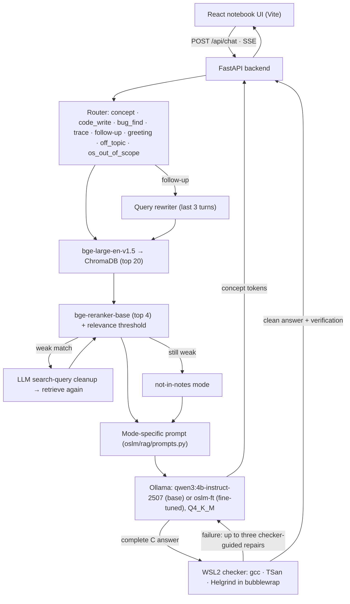

# OSlm — a process-synchronization tutor that runs on a laptop

OSlm answers questions about **process synchronization** (race conditions, critical sections, Peterson's algorithm,
locks, semaphores, condition variables, monitors, deadlock and the classical problems) like a teacher: example first,
then the rule, then a quick check-your-understanding question. It combines

- **Retrieval-augmented generation** over vetted course material (OSTEP, *The Little Book of Semaphores*, Linux/POSIX man
  pages, Wikipedia, plus your own course files), with inline `[n]` citations;
- a **QLoRA fine-tune of Qwen3-4B-Instruct-2507** trained on 381 checked examples in the tutor's style (every C
  program in the data verified under ThreadSanitizer and Helgrind);
- a **C code checker** that compiles programs and runs them under ThreadSanitizer and Helgrind inside a sandbox;
- a **notebook-style web app** where answers are "handwritten" onto ruled paper.

Team: Arush James (24BAI0277), Sayak Mondal (24BCE0884), Rohan Chaudhary (24BCE0906).

## Architecture



The same `config.yaml` switch (`setup: base | base_rag | ft | ft_rag`) — or the two checkboxes on the app's sticky note —
selects one of the four setups compared in the evaluation.

## Windows setup

Everything runs natively on Windows 11 except the code checker, which uses a minimal WSL2 Ubuntu (ThreadSanitizer,
Valgrind and bubblewrap are Linux-only). You never need to work inside WSL.

1. **Prerequisites:** NVIDIA driver (RTX-class GPU with 8 GB), Python 3.11, Node 20+ LTS, Git, and
   [Ollama for Windows](https://ollama.com/download). Put the project on a local, non-synced path.
2. **uv:** `py -3.11 -m pip install --user uv` (then use `%APPDATA%\Python\Python311\Scripts\uv.exe`, or add that folder
   to `PATH`). On a slow connection set `$env:UV_HTTP_TIMEOUT = "600"`.
3. **Python environment:** `uv sync` (installs the CUDA 12.8 PyTorch wheel and everything else).
4. **WSL2 (one time, admin):** `wsl --install -d Ubuntu`, reboot, create the Linux user. Then install the checker tools:
   `(Get-Content oslm\checker\wsl\setup.sh) -join "`n" | wsl -d Ubuntu -u root --exec bash -s`
   (installs gcc, valgrind, bubblewrap, util-linux; safe to re-run).
5. **Base model:** `ollama pull qwen3:4b-instruct-2507-q4_K_M`.
6. **Secrets (optional):** copy `.env.example` to `.env` and set `GEMINI_API_KEY`. It is only used for the LLM judge
   in `oslm eval` and for optional Gemini-based data generation (`sft.provider: gemini`); free Flash models only.
   Without it the judge falls back to the local `qwen3:8b`.
7. **Frontend:** `cd web; npm install; npx playwright install chromium`.
8. **Fine-tuned model:** `oslm train` then `oslm export` (see below), or skip it and use the base setups only.
9. **Check:** `uv run oslm doctor` — every line should be OK (the fine-tuned model shows WARN until you build it).

Ollama starts automatically with Windows. Quit it from the tray before `oslm train` so the GPU's 8 GB is free; start it
again (or run any `ollama` command) before `oslm export`, `oslm serve` or `oslm eval`.

If long paths are disabled, run once as admin:
`reg add HKLM\SYSTEM\CurrentControlSet\Control\FileSystem /v LongPathsEnabled /t REG_DWORD /d 1 /f`.

## Run the app

```powershell
uv run oslm serve        # FastAPI on http://127.0.0.1:8000 (pre-loads models and boots WSL)
uv run oslm web          # Vite dev server on http://localhost:5173
```

Open http://localhost:5173. **Ask** for questions and follow-ups, **Check my code** to run the sandboxed checker on a
C program, **About** for the method. Click an answer while it is being written to finish it instantly. The two
checkboxes on the sticky note switch between the four setups (base / fine-tuned, with or without the course notes).
The app opens with base model + notes (`base_rag`), the best setup in the evaluation; tick "Fine-tuned model" to compare.

Give the backend ~30 s after it starts: it pre-loads the embedder, reranker and the Ollama model and boots WSL. After
that the first handwritten words appear in about 2 s.

## Rebuild every stage

| Stage | Command | Output |
|---|---|---|
| Environment check | `oslm doctor` | pass/fail list |
| Ingest web sources + `data/course/` | `oslm ingest` (`--force` re-extracts from the HTTP cache) | `data/raw/manifest.jsonl`, `data/raw/docs/` |
| Clean, chunk, embed, index | `oslm index` (`--force` rebuilds) | `data/chunks/chunks.jsonl`, `data/chroma/` + retrieval smoke score |
| Eval testset (119 items, checker-verified) | `oslm eval --suite build-testset` (Gemini) | `data/eval/testset.jsonl` |
| Probes (§9.3) | `python data/eval/probes_src.py` | `data/eval/probes.jsonl` |
| SFT data from a Q&A CSV | `oslm sft --step import --csv <file>` then `--step verify`, `--step format`, `--step review` | `data/sft/train.jsonl`, `val.jsonl`, `review.html` |
| SFT data generated by an LLM (optional) | `oslm sft --step generate [--until-done]` (`sft.provider: ollama` or `gemini`) | `data/sft/raw/*.jsonl` |
| QLoRA training | quit Ollama, then `oslm train` (`--resume latest` to continue) | `models/adapter/` |
| Merge + register in Ollama | `oslm export` (streaming merge → llama.cpp F16 GGUF → Ollama Q4_K_M) | Ollama model `oslm-ft` |
| Evaluation | `oslm eval` | `data/eval/results/summary.md`, `results.json`, `probes_summary.md`, PNG plots |
| All tests | `oslm test` (`--integration --e2e` for the live suites) | pass/fail summary |
| Clean up | `oslm clean` (dry run) / `oslm clean --yes` | removes caches and intermediates |

Course files (lecture PPTX, lab manuals, past papers, your Silberschatz chapters) go in `data/course/`. They are
gitignored and never redistributed; re-run `oslm ingest` and `oslm index` after adding them.

### How the fine-tuning data was built

The training set came from two externally written Q&A files (`process_synchronization_training*.csv`, 560 rows) plus
25 Gemini-generated pilot answers. `oslm sft --step import` gives every row the same treatment the live pipeline
applies: the router's mode, the course-note chunks the retriever would fetch, and `[n]` citations added only where an
answer sentence closely matches a chunk (explanations with no supported citation become "no notes" examples so the
model never learns to ignore attached notes). Verification then compiles and runs every C program under TSan and
Helgrind, rejects answers that break the format rules, removes near-duplicates (152 templated rows) and anything close
to the evaluation questions. Result: 381 examples (343 train / 38 validation), including explicit short-answer
follow-ups so the tutor learns to grade replies such as "I think the gate" instead of replaying the previous lesson.

### Training notes (Windows, 8 GB GPU)

- TRL's `SFTTrainer` (1.15) always uses a Triton loss kernel, and Triton is Linux-only, so `oslm train` uses the plain
  `transformers` `Trainer` with its own tokenisation (loss on the final answer and its end-of-turn token only) and a
  memory-light loss that projects to the 152k-token vocabulary only at answer positions.
- Sequences are capped at 2,048 tokens and PyTorch's allocator is capped below the card's 8 GB. Going over the limit
  makes Windows page into shared memory, which was 5× slower and preceded a driver crash during development.
- 2 epochs, 44 optimizer steps on an RTX 4070 Laptop; validation loss reached 1.652 and peak allocated VRAM was
  7.21 GB.

## Evaluation results

119 test items (40 concept, 40 code-write, 39 find-the-bug) and 38 examiner-style probes, identical decoding for all
setups, judged by a local `qwen3:8b` with a fixed rubric; code metrics come from the WSL sandbox.

| | base | base_rag | ft | ft_rag |
|---|---|---|---|---|
| Correctness (0–2) | 1.39 | **1.50** | 0.96 | 1.03 |
| · concept / code-write / find-the-bug | 1.80 / 1.05 / **1.33** | **1.95 / 1.32** / 1.21 | 1.60 / 0.45 / 0.82 | 1.77 / 0.35 / 0.95 |
| Grounding (claims supported by cited notes) | — | **87%** | — | 72% |
| Bug-finding F1 | **0.77** | 0.74 | 0.76 | 0.70 |
| Probe pass rate | 68% | **74%** | 61% | 66% |
| Correct out-of-scope declines | **100%** | 75% | **100%** | **100%** |
| Time to first token / total (p50) | 0.40 s / 11.0 s | 0.79 s / 7.9 s | **0.38 s / 3.8 s** | 0.77 s / 4.2 s |
| Retrieval hit@4 / MRR | — | 95% / 0.90 | — | 92% / 0.88 |

These are the original 2026-10-11 baseline results and remain recorded for reproducibility. They motivated the
2026-10-19/20 repair: the importer removes boilerplate, verification rejects incomplete answers, explicit
short-answer follow-ups were added, and the fine-tune was rebuilt. Serving now uses history-aware routing,
safe multilingual/long-prompt fallbacks, and buffered compile/TSan/Helgrind checks with up to three checker-guided
repair attempts. On 2026-10-20, a fresh forced run of the 38-probe fine-tuned suite scored **92% (35/38)**, up from
the 61% baseline. Every category passed at 100% except typo robustness (67%) and complex C generation (0%): the two
classical synchronization programs that remained unsafe after the bounded repair loop were explicitly flagged
instead of being presented as verified. See
[`analysis.md`](data/eval/results/analysis.md) for the full analysis and recommendations,
[`summary.md`](data/eval/results/summary.md) for every metric, and
[`probes_summary.md`](data/eval/results/probes_summary.md) for probe pass rates per category.

Retrieval smoke set (30 questions): hit@5 = 1.00 and MRR = 0.94 (dense), 1.00 / 0.94 after reranking.

## Repository layout

```
oslm/      ingest · index · rag · checker (wsl/ scripts run inside WSL) · sft · train · eval · api · cli.py
web/       React 18 + Vite + Motion + Radix + Zustand + Zod notebook UI (Vitest + Playwright tests)
data/      sources live here; course/, raw/, chunks/, chroma/ are gitignored; sft/ and eval/ are tracked
models/    adapter, merged weights (gitignored); Modelfile tracked
tests/     pytest suites mirroring oslm/ (+ C fixtures for the sandbox)
```

## References

- R. H. Arpaci-Dusseau and A. C. Arpaci-Dusseau, *Operating Systems: Three Easy Pieces* (concurrency chapters).
- A. B. Downey, *The Little Book of Semaphores*, Green Tea Press.
- A. Silberschatz, P. B. Galvin, G. Gagne, *Operating System Concepts* (course textbook; not redistributed).
- Linux man-pages project and POSIX.1-2017 manual pages (pthreads, semaphores).
- T. Dettmers et al., "QLoRA: Efficient Finetuning of Quantized LLMs," NeurIPS 2023.
- E. J. Hu et al., "LoRA: Low-Rank Adaptation of Large Language Models," ICLR 2022.
- P. Lewis et al., "Retrieval-Augmented Generation for Knowledge-Intensive NLP Tasks," NeurIPS 2020.
- S. Xiao et al., "C-Pack: Packaged Resources To Advance General Chinese Embedding" (BGE models), 2023.
- Qwen Team, *Qwen3 Technical Report*, 2025.
- K. Serebryany and T. Iskhodzhanov, "ThreadSanitizer: data race detection in practice," WBIA 2009.
